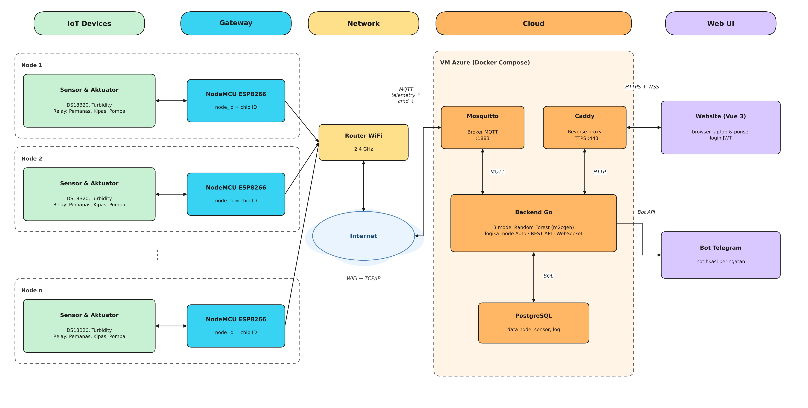
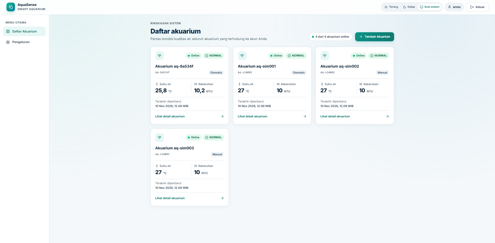
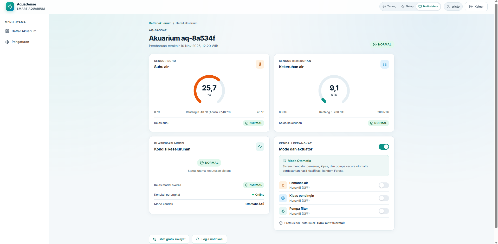

# AI Smart Aquarium

Sistem IoT untuk memantau dan mengendalikan kualitas air akuarium (suhu dan kekeruhan). Data dari NodeMCU ESP8266 dikirim lewat MQTT ke server mandiri, diklasifikasikan oleh tiga model Random Forest, lalu hasilnya langsung menentukan aksi pemanas, kipas, dan pompa filter. Sistem mendukung banyak akuarium dan banyak pengguna, tanpa platform IoT pihak ketiga.

Tugas Besar Teknologi IoT 2026 — Program Studi Informatika, FTIDS, Universitas Sebelas Maret.

- Website: https://smart-aquarium.duckdns.org
- Video demo: [tautan video]



## Fitur

- Pemantauan suhu dan kekeruhan secara real-time (WebSocket)
- Tiga model Random Forest (suhu, kekeruhan, overall) dengan empat kelas: NORMAL, CAUTION, WARNING, SEVERE. Status utama = kelas paling parah.
- Mode Auto (aktuator mengikuti hasil model) dan mode Manual (kendali dari website)
- Fail-safe di perangkat: kendali lokal saat heartbeat server hilang lebih dari 3 menit
- Pengaman sensor suhu: pemanas dan kipas dimatikan jika DS18B20 gagal dibaca 10 detik
- Multi-node: node baru terdaftar otomatis tanpa mengubah kode server
- Akun klien dan admin, klaim akuarium dengan kode klaim 8 karakter
- Notifikasi Telegram ke pemilik akuarium
- Grafik riwayat, log aktuator dan peringatan, tampilan responsif, tema terang/gelap




## Teknologi

| Lapisan | Teknologi |
| --- | --- |
| Perangkat | NodeMCU ESP8266, DS18B20, sensor kekeruhan analog, relay 4 channel, pemanas, kipas, pompa filter |
| Komunikasi | MQTT (Eclipse Mosquitto) |
| Backend | Go, inferensi Random Forest hasil konversi m2cgen |
| Model | scikit-learn, 3 Random Forest (50 pohon, kedalaman 8) |
| Basis data | PostgreSQL |
| Website | Vue 3, Vite, Tailwind CSS, ECharts, Lucide, login JWT |
| Notifikasi | Bot Telegram |
| Hosting | Docker Compose di VM Azure, Caddy (HTTPS), DuckDNS |

## Struktur repositori

| Folder | Isi |
| --- | --- |
| `firmware/smart_aquarium/` | Program NodeMCU (Arduino C++) |
| `ml/` | Notebook pelatihan dan hasil konversi model |
| `backend/` | Server Go (MQTT, inferensi, keputusan, REST API, WebSocket, notifikasi) |
| `db/migrations/` | Skrip SQL basis data |
| `frontend/` | Website Vue 3 |
| `tools/simulator/` | Simulator node untuk uji multi-node |
| `deploy/` | Docker Compose produksi, Caddyfile, konfigurasi Mosquitto, skrip deploy |
| `docs/` | Kontrak sistem dan dokumentasi |

Kontrak antarbagian (topik MQTT, REST API, skema basis data) ada di `docs/kontrak.md`.

## Menjalankan secara lokal

Butuh Docker Desktop dan Node.js.

```bash
docker compose up -d                                   # PostgreSQL, Mosquitto, backend
docker compose run --rm simulator                      # node simulasi
cd frontend && npm install && npm run dev              # website
docker compose run --rm --no-deps backend go test ./...  # unit test backend
```

## Firmware

1. Salin `firmware/smart_aquarium/config.example.h` menjadi `firmware/smart_aquarium/config.h`, lalu isi alamat broker dan akun MQTT.
2. Buka `firmware/smart_aquarium/smart_aquarium.ino` di Arduino IDE (board ESP8266) dengan pustaka OneWire, DallasTemperature, PubSubClient, ArduinoJson, dan WiFiManager.
3. Upload ke NodeMCU. Saat pertama menyala, sambungkan ke WiFi `SmartAquarium-{chipID}` untuk memilih jaringan WiFi.

## Deploy ke VM

1. Salin `.env.example` menjadi `.env` di root repo, lalu isi semua nilainya.
2. Buat file password Mosquitto (langkah lengkap di `deploy/README.md`).
3. Jalankan `sh deploy/deploy.sh`.

Rahasia (`.env`, `firmware/smart_aquarium/config.h`, `deploy/mosquitto/passwd`) tidak disimpan di repositori.

## Hasil pengujian

- 24 dari 24 skenario lulus (unit test, simulator, alat asli, akun dan kepemilikan)
- Waktu proses server per data: 5–9 ms
- Node yang mati terdeteksi offline dalam kurang dari ±1,5 detik (LWT)
- Telemetry tiap 10 detik tanpa data hilang

## Anggota kelompok

- Abdurrahman Rasyid S. — L0123002
- Aristo Budiman — L0123028
- Bintang Cahaya P. — L0123037
- Kevin Marcelino P. — L0123073
- Primus Putra Prima — L0123111
